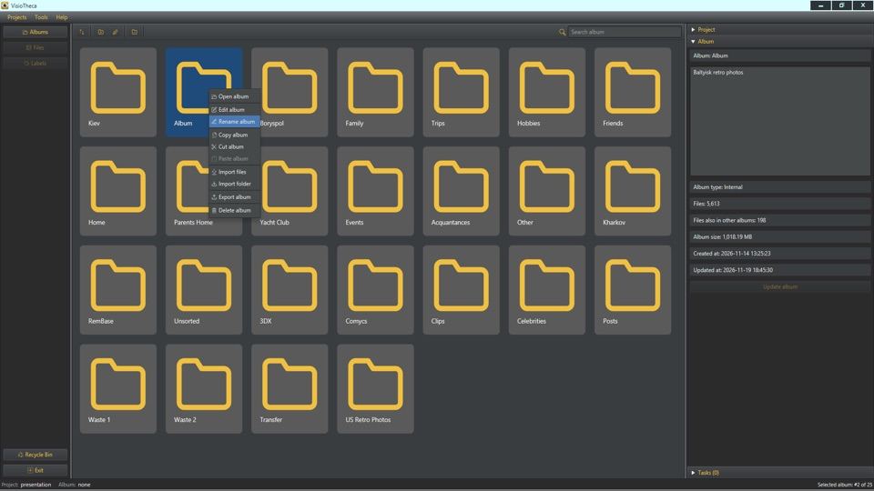
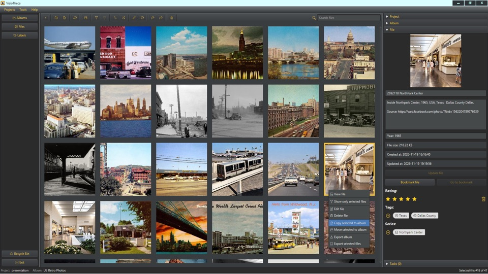
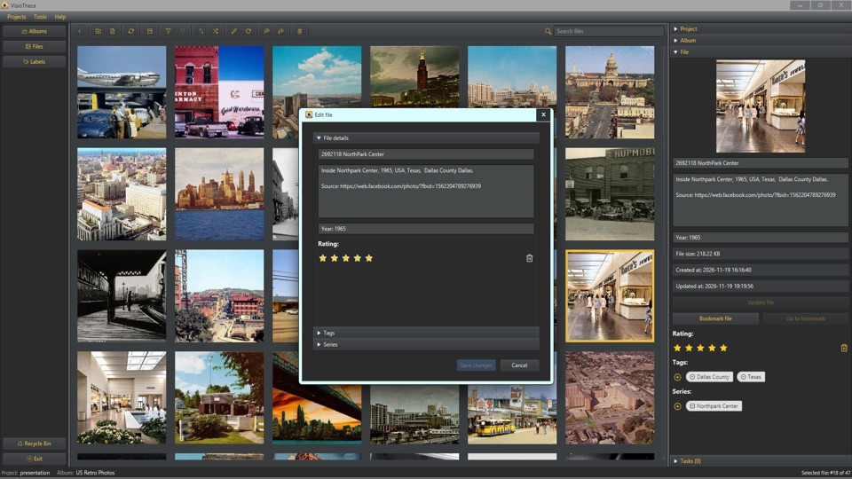
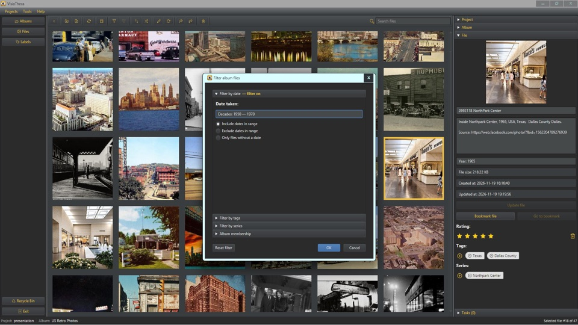
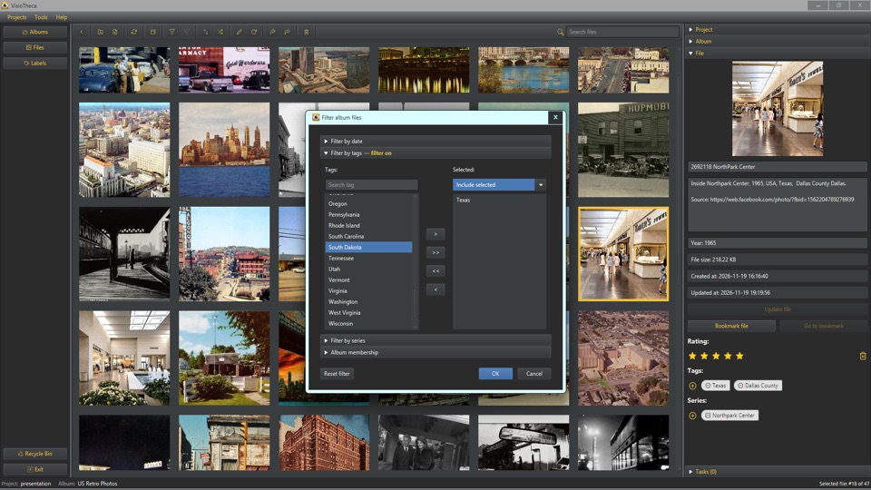
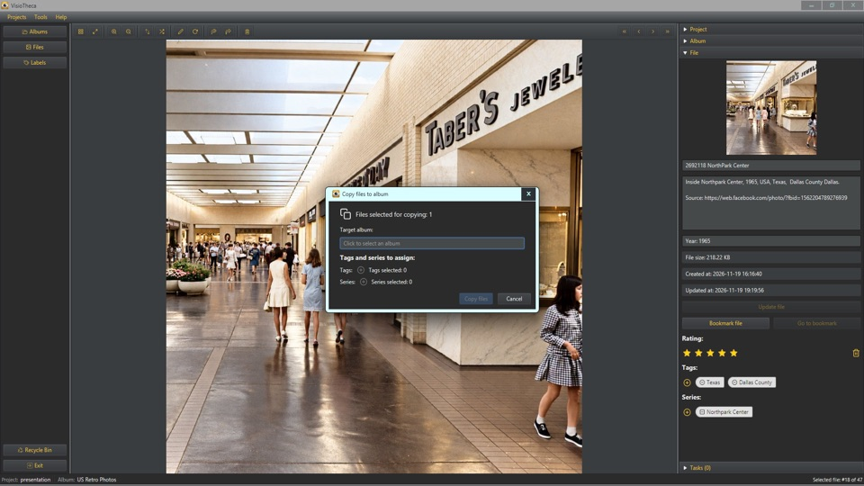
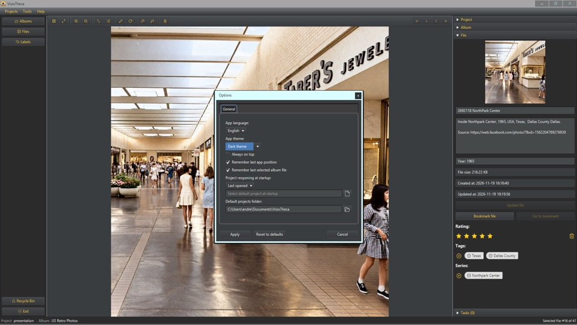
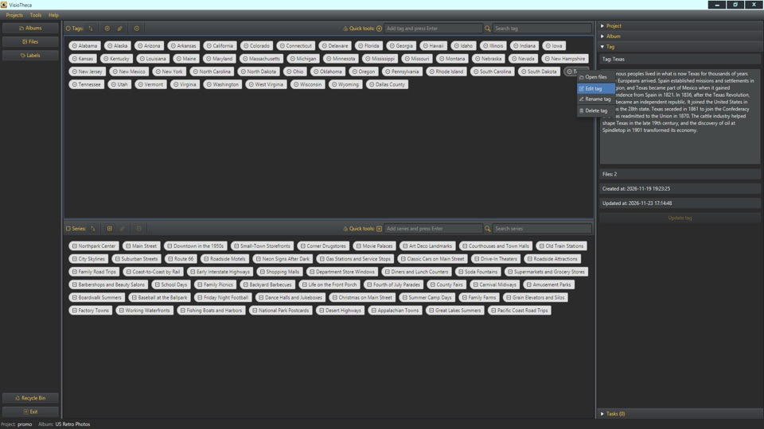

**VisioTheca** is a free Windows photo organizer built with JavaFX by Andrey Naumov.

The idea grew out of an interest in historical photographs of Kyiv. Sometimes you can recognize a street and narrow a photo down to a decade, even if the exact year is unknown. VisioTheca lets collectors record that date range, group related photos into series, and search their collections by date or tag.

#### Key Features

- **Date ranges:** Record an approximate period for photos with an unknown exact date.
- **Series:** Group related photos together.
- **Search:** Find photos in your collection by date or tag.

### Video Manual

### Application Screenshots

### Links

- [Project page](https://rembase.org/photo/visiotheca)
- [Download for free on the Microsoft Store](https://apps.microsoft.com/detail/9n503j7rqwt3)
